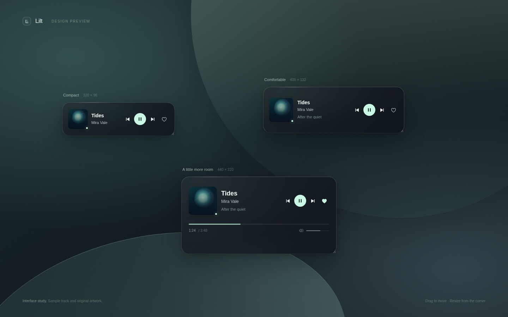

# Lilt

A small Spotify widget that stays within reach.

Built for Windows 10 22H2 and the Spotify desktop app. Resize the card to make room for more information. Keep it small when you just need the essentials.



- Album art, track, artists, playback status and transport controls.
- Likes through your Spotify account.
- Translucent glass, adjustable opacity and an always-on-top window.
- Settings in the tray. An optional click-through mode lets you work underneath the card.
- Local controls without signing in; account controls when connected.

## Run

Download `Lilt-win-x64.zip` from [Releases](https://github.com/MF011/lilt/releases), extract it, then open `Lilt.exe`. The portable build includes the .NET runtime.

Start Spotify and play something. Drag an empty part of the card to move it. Drag the grip in the bottom-right corner or an edge to resize it. Right-click Lilt's tray icon for settings.

The smallest layout is 288 × 88. It keeps the cover, title, artists and previous/play/next buttons. Hover the cover to like a track. More space reveals the album, then the timeline and available volume controls.

| Shortcut | Action |
| --- | --- |
| `Ctrl+Alt+L` | Show or hide the widget |
| `Ctrl+Alt+Shift+L` | Toggle click-through |

The tray remains usable while click-through is on.

**Glass** lets the desktop show through the card. Choose a tint under **Glass opacity**, or turn **Glass** off for a solid background.

Turn on **Refraction** in the tray to bend the image behind the card. The lens follows as you drag and holds the last frame while you resize. Open **Refraction settings…** for bend, softness, color split, and a reduced-resolution option. Normal widget sizes use the display’s native pixel density by default.

Lilt keeps sampled pixels in memory. It tries display capture first, then the app window underneath. The card uses plain glass when neither source is available. If you see **Refraction (unavailable)**, try placing the entire card over an ordinary app such as Notepad. The card may be left out of display recordings while Refraction is enabled.

## Connect Spotify

Playback works locally without a Spotify developer app. Likes need an API connection using your own Client ID. No client secret is required.

Follow the [Spotify setup](docs/spotify.md). Account mode uses Spotify's active device, so it can also follow playback moved to another device. Local mode controls the desktop Spotify session.

If the API is offline or rate limited, Lilt falls back to local controls. Likes wait until the connection recovers.

## Build

Install the [.NET 10 SDK](https://dotnet.microsoft.com/download/dotnet/10.0) on Windows, then run:

```powershell
dotnet build Lilt.slnx -c Release
dotnet run --project tests/Lilt.Checks -c Release
dotnet run --project tests/Lilt.Spotify.Checks -c Release
dotnet run --project src/Lilt.App -c Release
```

To build a portable package:

```powershell
./scripts/build.ps1
```

The zip is written to `artifacts/Lilt-win-x64.zip`.

## Before reporting a bug

This is an early version. Spotify's available commands depend on the client and device. Always-on-top covers ordinary windows and borderless games. Exclusive fullscreen and Windows security screens can cover the card.

If something breaks, include your Windows build, Spotify version, playback mode and steps to reproduce it. Never include tokens or the contents of Lilt's local data folder.

The [Windows checklist](docs/windows-checklist.md) covers the manual checks used before a release.

## Source

WPF handles the card. Win32 handles the window, tray and hotkeys. Windows media sessions provide local playback; the Spotify Web API provides account playback and library actions.

Settings and credentials live under `%LOCALAPPDATA%\Lilt`. Tokens are protected for the current Windows user. There is no hosted backend.

MIT licensed. Lilt is an independent project and is not affiliated with Spotify.
